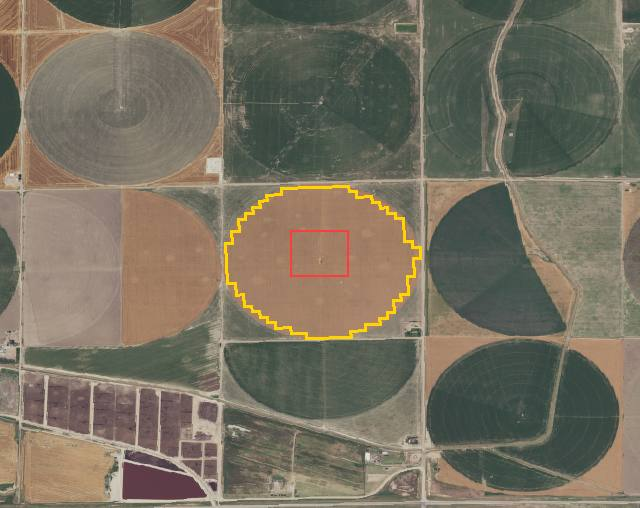
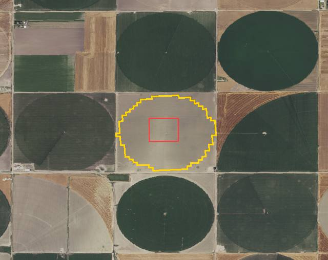
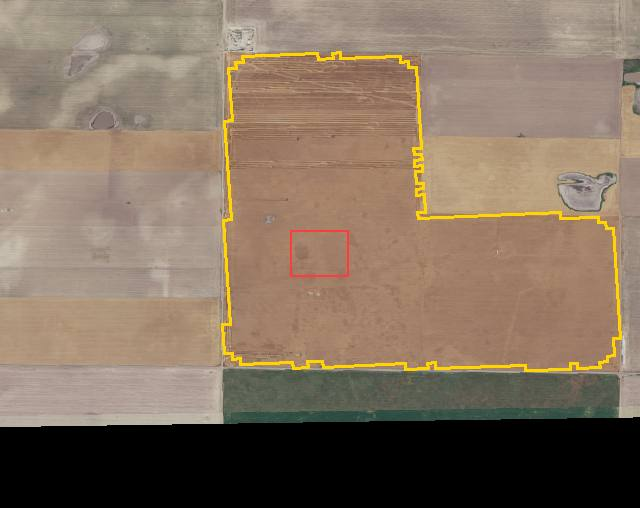
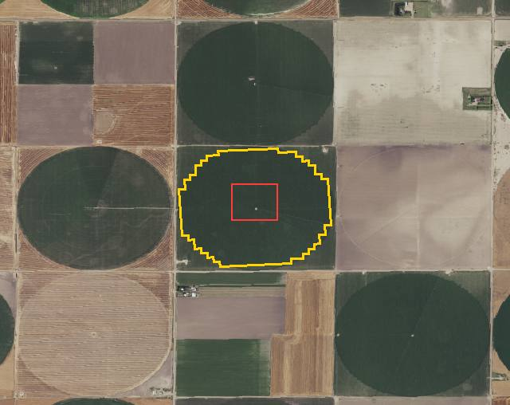
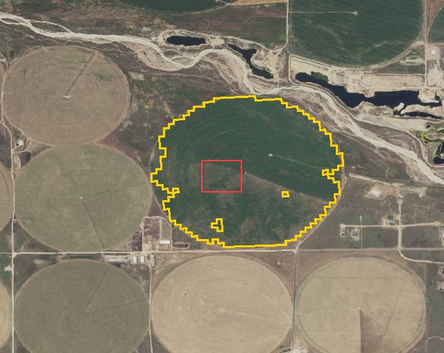
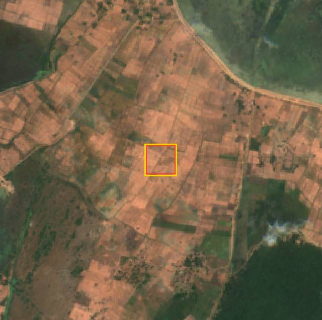
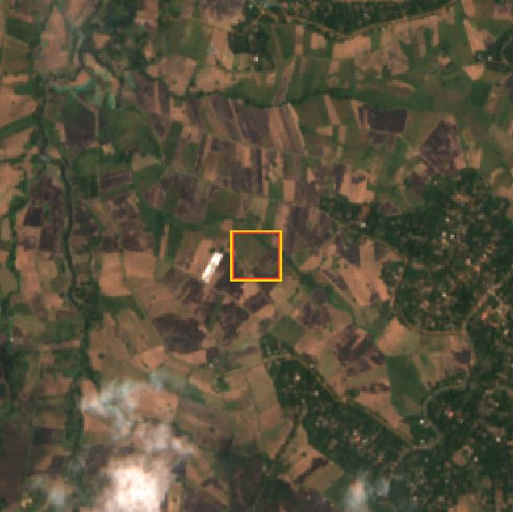
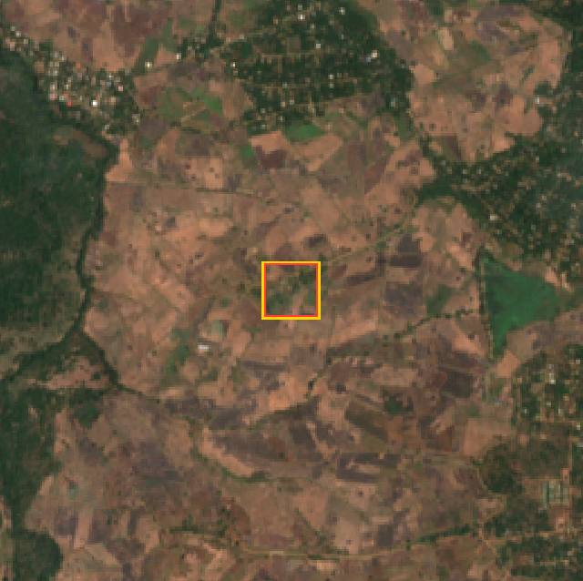

# Site search: real fields for decision D3

Owner: M3 · 2026-11-14 · Status: **shortlist for the team to decide**. Nothing here is recorded as a
decision. D3 stays open in `docs/decisions.md` until the team picks.

## Why this exists

The two original candidate points were rough locations near towns. Land-cover checks showed neither is a
field: the Kansas point is **inside Garden City** (ESA WorldCover 2021: 93 % built-up; USDA CDL 2021–2024:
"Developed"), and the Sri Lanka point is trees at the edge of Anuradhapura (76 % tree cover). Weather and
soil barely change over a few km, but **satellite season detection needs a real field**.

Reproduce: `cd backend && uv run python scripts/find_candidate_fields.py` (Earth Engine sign-in needed).
Outlines for all candidates: [`candidates.geojson`](candidates.geojson) (opens as a map on GitHub).

## How candidates were found

- **Kansas:** USDA Cropland Data Layer (30 m). A point qualifies only if the ~510 m square around it was
  **one cropped field in every year 2018–2024**. Any MODIS pixel (232 m) at that point then lies entirely
  inside the field, so season detection sees only that field. The outline is the patch with the same crop
  as the point in every year.
- **Sri Lanka:** there is no field-level crop map, so ESA WorldCover (10 m) was used: ≥ 90 % cropland
  across a ~250 m block. Within 30 km of Anuradhapura **no** fully cropped 500 m block exists. Within 50 km,
  three ~250 m blocks qualify.
- Each candidate also shows MODIS NDVI (16-day, QA good/marginal) as an independent sign of cropping.

In the photos, the **red square** is the MODIS pixel and the **yellow line** is the field outline (Kansas)
or the ~250 m block (Sri Lanka).

## Kansas: single fields near Garden City (same weather region as the original point)

| | Field | km from original | Area | Crop history 2018 → 2024 (CDL) | Yearly NDVI peak | Notes |
|---|---|---|---|---|---|---|
|  | **ks-field-2** (38.01517, −100.92496) | 6.9 | ~46 ha | Corn ↔ Winter wheat, alternating | 0.72–0.93 | Centre-pivot (irrigated). Two-crop rotation, close to the original point |
|  | **ks-field-3** (38.03647, −100.96163) | 10.9 | ~45 ha | Corn ↔ Sorghum, alternating | 0.82–0.90 | Centre-pivot (irrigated). Clean circle |
|  | **ks-field-5** (38.06698, −100.78774) | 12.9 | ~183 ha | Fallow → Wheat → Corn → Fallow → Wheat → Sorghum → Fallow | 0.34–0.84 | **Dryland** wheat–row crop–fallow, the classic water-limited rotation of western Kansas |
|  | ks-field-4 (38.05111, −100.97057) | 12.6 | ~47 ha | Corn ×3, then Sorghum ↔ Corn | 0.81–0.88 | Centre-pivot (irrigated) |
|  | ks-field-1 (37.95880, −100.93362) | 5.7 | ~93 ha | Alfalfa every year | 0.86–0.92 | Perennial alfalfa: **no rotation to compare**, weak fit |

Photos: USDA NAIP aerial imagery (~1 m), 2023-07-17. MODIS usable composites: 84–98 % per field.

## Sri Lanka: cropland blocks (many small plots, not single fields)

| | Block | km from original | Yearly NDVI amplitude | Notes |
|---|---|---|---|---|
|  | sl-block-3 (8.74386, 79.97941) | 66.7 | 0.56–0.74 | Strongest seasonal signal; small plots beside a village reservoir (tank), so **likely tank-irrigated paddy** |
|  | sl-block-2 (8.24799, 80.73848) | 37.9 | 0.36–0.53 | Small plots mixed with trees and homesteads |
|  | sl-block-1 (8.02386, 80.36164) | 31.9 | 0.29–0.53 | Small plots mixed with trees |

Photos: Copernicus Sentinel-2 L2A (10 m), median of Jan–Apr 2024 (dry season). MODIS usable
composites: only 60–75 % (monsoon cloud).

## What the evidence says (for the team to weigh)

1. **Kansas has clean, single, field-sized candidates** with a real multi-year crop history from data.
   That history can be the app's *current practice* row instead of an assumption.
2. **Sri Lanka has no single field a MODIS pixel can isolate.** The best are blocks of 10–30 farmers' plots,
   likely paddy. The guide says flooded paddy needs ponding/percolation modelling and **prefers an upland
   pilot** if that cannot be supported (guide §3).
3. Within Kansas, the choice is about the story:
   - **Irrigated pivot (ks-field-2 or ks-field-3):** water allocation is the hard constraint (Ogallala
     aquifer). Good for the "irrigation needed" vs "fixed allocation" modes and water-saving alternatives.
   - **Dryland (ks-field-5):** rainfall-only, with fallow as the current practice. Good for soil-cover,
     low-cover exposure and cover-crop trade-offs.

## Limits of this evidence

- CDL is a classified map: field-level accuracy is high for major crops but not perfect. Outlines are
  approximate (30 m). Irrigation is inferred from centre-pivot shape and high NDVI, not from a water record.
- None of this replaces **local confirmation** (planting dates, irrigation allocation, equipment). The
  guide requires a locally reviewed site.
- WorldCover is a single year (2021) and does not separate crop types.

## After the team picks

One command per data source loads everything for the chosen field (weather, soil, MODIS). Then record D3 in
`docs/decisions.md` with date, owner and rationale.

## Sources

USDA NASS Cropland Data Layer 2018–2024 (public domain) · ESA WorldCover 10 m v200 2021 (CC BY 4.0) ·
MODIS MOD13Q1 v061, doi:10.5067/MODIS/MOD13Q1.061 · USDA NAIP imagery (public domain) · Copernicus
Sentinel-2 L2A (contains modified Copernicus Sentinel data 2024). All accessed via Google Earth Engine.
