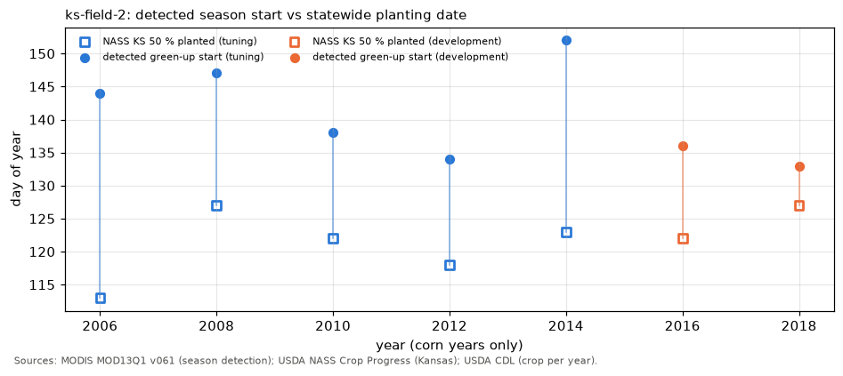

# Validation results

Owner: M5. Each entry follows the pre-registered plan (`docs/validation-plan.md`). Failures and small samples
are reported as they are. No result here was used to change the plan.

## Season detection vs planting dates: `ks-field-2` (2026-11-14)

**Plan:** v1.2 (the reference rules were committed and pushed *before* this comparison was run).
**Reproduce:** `cd backend && uv run python scripts/evaluate_phenology.py --site-id ks-field-2`
(full record with per-year rows and the tuning table: `results/validation/phenology_ks-field-2.json`).

| | Years | Scored seasons (n) | Detected | Bias (detected − reference) | Median abs. error |
|---|---|---|---|---|---|
| Tuning | 2006–2014 (corn: 2006, 2008, 2010, 2012, 2014) | 5 | 5 / 5 | **+22.4 days** | 20 days |
| Development check (no retuning) | 2015–2019 (corn: 2016, 2018) | 2 | 2 / 2 | +10.0 days | 10 days |
| Held-out test | 2020–2025 | — | **not evaluated yet** (locked until feature freeze) | — | — |

**Chosen parameters** (from the pre-declared grid only): Savitzky–Golay window 9 composites, polynomial order 2,
threshold fraction 0.2. Order 2 and 3 gave identical results; the tie went to the simpler order 2.

### What this means
- Every scored corn season was found.
- The satellite start is **2–3 weeks after the statewide 50 % planting date**. This is the expected direction:
  the detected start is canopy green-up, which follows planting and emergence. It is a lag, not a planting date.
- The development years are closer (+14 and +6 days) without retuning, which argues against overfitting.

### Limits and failures (stated, not hidden)
- **Small samples:** n = 5 for tuning and **n = 2 for the development check, too few to judge**.
- **The reference is statewide**, not this field: a single field can plant weeks earlier or later than the
  Kansas median, and western Kansas often differs from the state.
- **Chosen fraction 0.2 is at the edge of the grid.** A lower value might fit better, but the grid was fixed in
  advance and is not widened after seeing results.
- **Not scored:** winter wheat (NASS planting is in autumn; the detected start is spring green-up), the
  double-crop seasons after wheat (CDL labels 2011 and 2013 "double crop winter wheat/sorghum"), and 2007
  (no CDL). The Extract card must therefore not present wheat or double-crop starts as validated.
- Crop labels come from USDA CDL, a classified map.

**Sources:** MODIS MOD13Q1 v061 (doi:10.5067/MODIS/MOD13Q1.061) · USDA NASS Crop Progress, Kansas (Quick Stats) ·
USDA NASS Cropland Data Layer 2006–2019.
